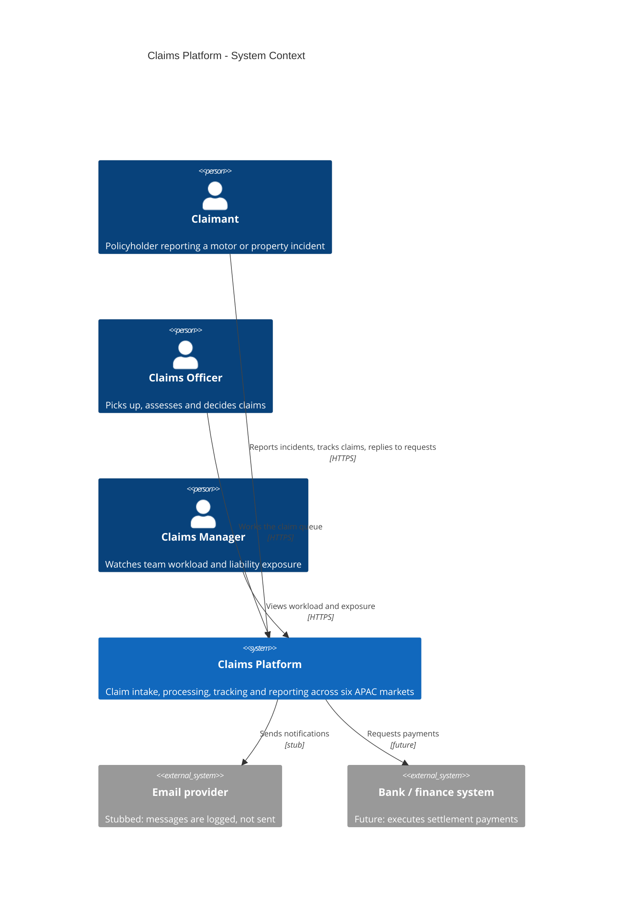
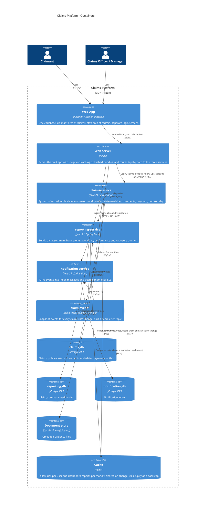

# System Architecture (C4)

## Level 1: System Context

## Level 2: Containers

## Why it is cut this way

| Decision | Reason | Trade-off accepted |
|---|---|---|
| Three services | Writes, dashboards and notifications have different load and consistency needs; reporting and notification can lag or be down without blocking a claim | More wiring and more to start locally than one service |
| REST for commands and queries | A user is waiting for the answer and needs a success or a clear error | None of note |
| Kafka for everything downstream | Notifications and read models happen because a claim changed; they must not slow or fail the change | Dashboards are eventually consistent (seconds) |
| Transactional outbox | The event row commits with the claim change, so an event is never published for a rolled-back write | At-least-once delivery, so consumers must be idempotent |
| Snapshot events | Consumers never call back into claims-service | Larger payloads; schema changes need care |
| Database per service | No hidden coupling through shared tables | No cross-service joins; data is duplicated in read models |
| JWT issued by claims-service, verified by each service | Every service checks identity itself; no shared session | Identity lives in claims-service for now; a dedicated identity provider is future work |
| No API gateway yet | nginx in the frontend container routes `/api` by path, so the browser talks to one origin | A gateway is needed before production for TLS and rate limits |
| Redis for two hot reads only | Follow-ups (every page change, every user) and the dashboard aggregates grow with usage; each is cleared when its data changes | One more container; everything else reads PostgreSQL directly so no other screen can go stale |

## Local runtime

`docker compose up -d --build` starts seven containers: PostgreSQL (one server holding
`claims_db`, `reporting_db` and `notification_db`), Kafka, Redis, the three services, and nginx
serving the built Angular app. nginx looks the services up through Docker's DNS on each request, so
a restarted service is found without restarting nginx. While changing code, the services and the Angular dev server can run on the
host against the PostgreSQL and Kafka containers instead.
