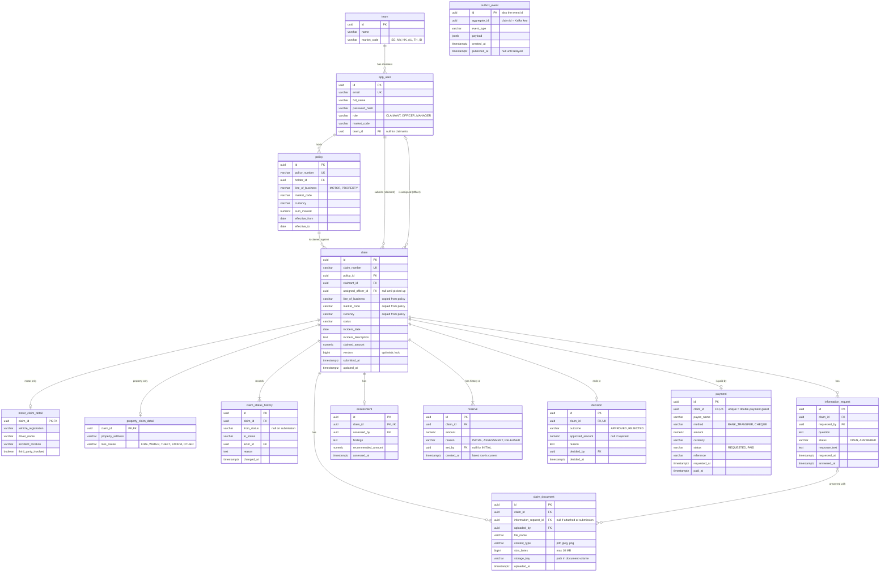
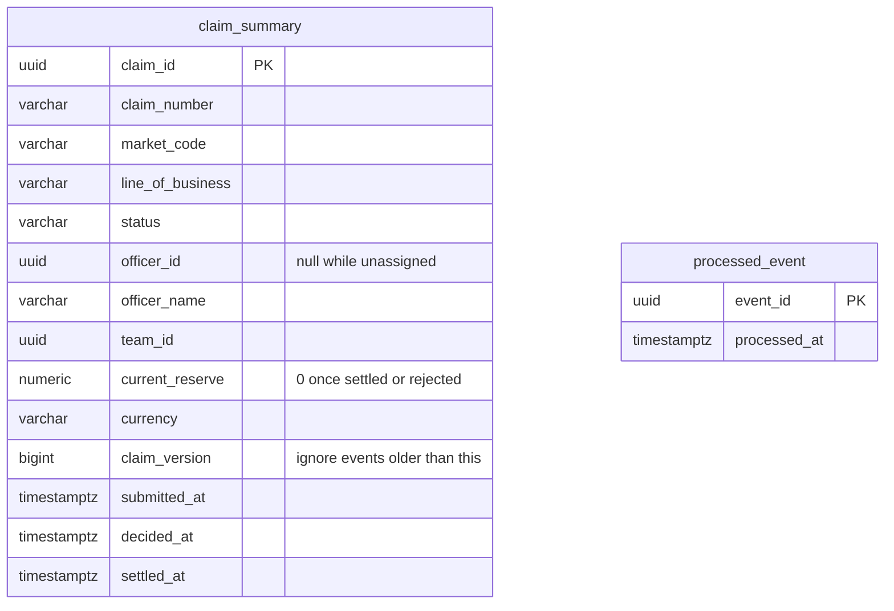
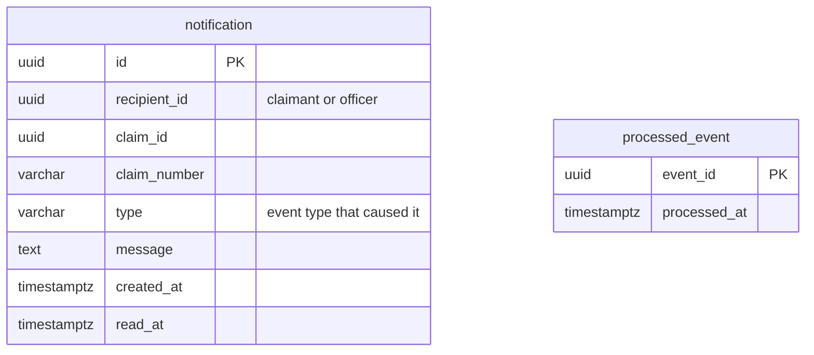

# Entity-Relationship Diagram

Three databases, one per service. No foreign keys cross a database boundary:
`reporting_db` and `notification_db` are built only from Kafka events.

## claims_db (system of record, owned by claims-service)

`outbox_event` has no foreign keys on purpose: it is written in the same
transaction as the claim change and read only by the relay.

## reporting_db (read model, owned by reporting-service)

Workload, performance and exposure are SQL aggregates over `claim_summary`.
Exposure = `SUM(current_reserve)` where status is not `SETTLED` or `REJECTED`,
grouped by market and line of business.

## notification_db (owned by notification-service)

## Designed, not built

| Item | What it would add |
|---|---|
| Manager approval | `approval` table and a `PENDING_APPROVAL` state above an officer authority limit |
| Multiple payments per claim | Drop the unique constraint on `payment.claim_id`; exposure becomes reserve minus paid |
| Payment processing | `PROCESSING` and `FAILED` payment states, driven by a payment service over Kafka |
| FX rates | `fx_rate` table for a single-currency consolidated exposure figure |
