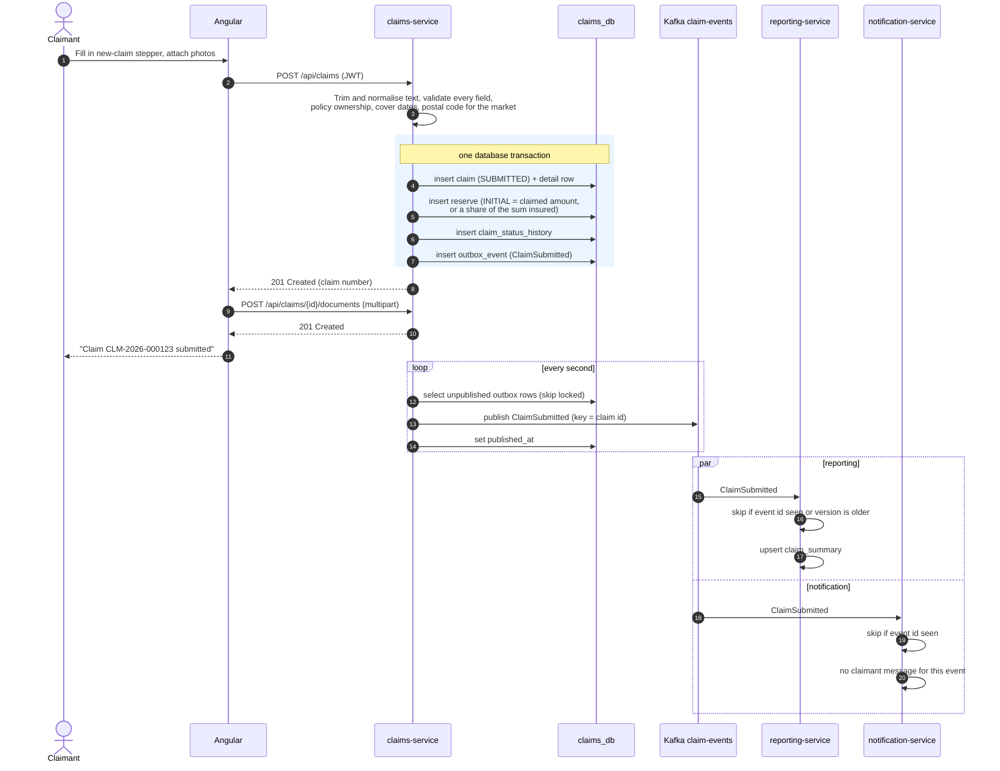
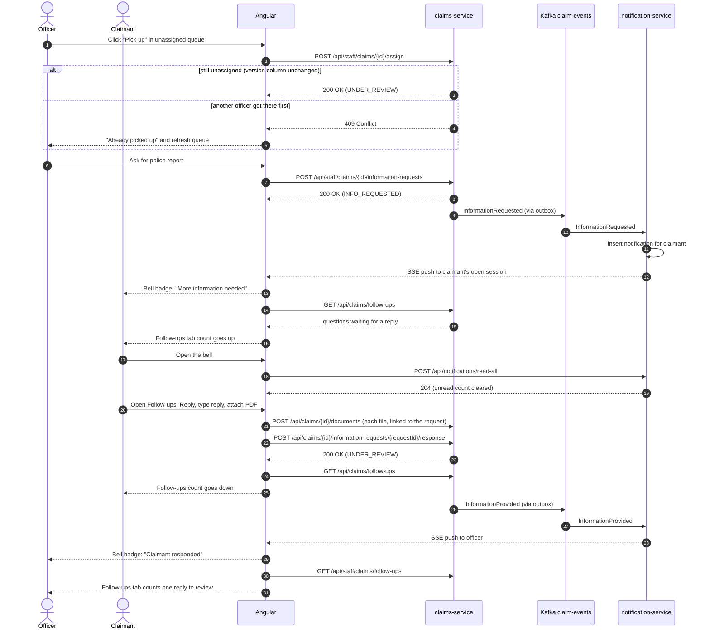
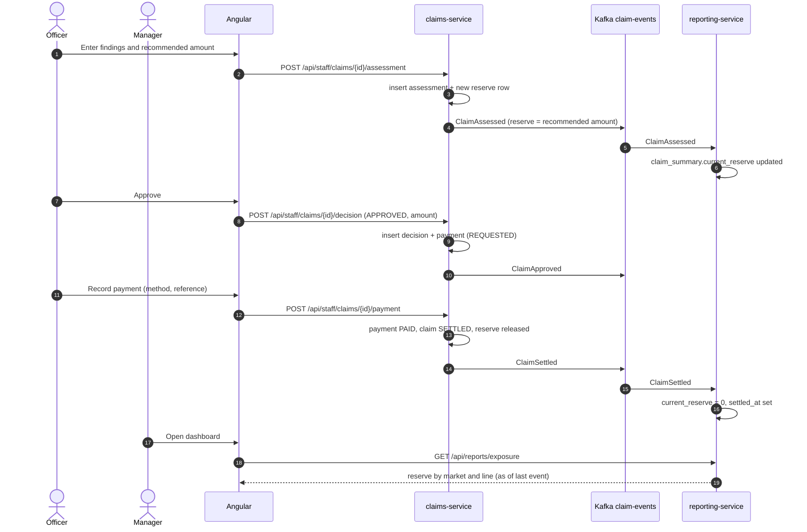
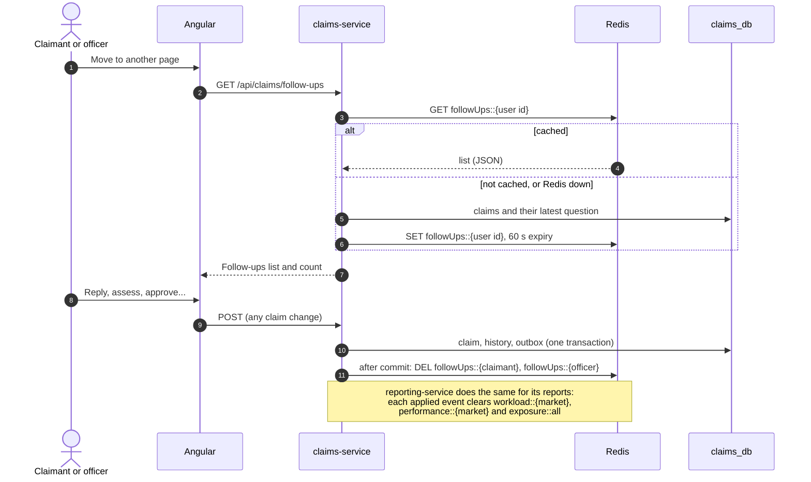
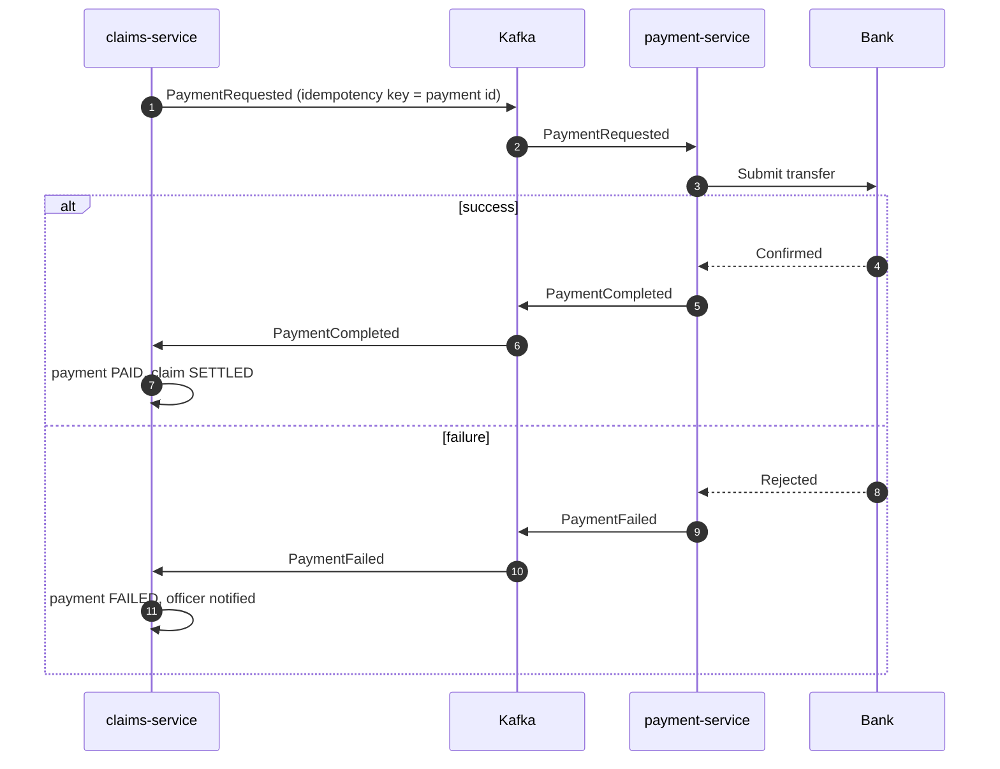

# Sequence Diagrams

## 1. Submit a claim (REST command, outbox, Kafka fan-out)

The pattern every state change follows.

If the service crashes between publishing and setting `published_at`, the event
is published again on restart. Consumers cope because they record each event id
in `processed_event`.

## 2. Pick up, request information, respond (async across both tiers)

The Follow-ups lists are not stored: `claims-service` works them out from each claim's status and
its latest information request, so they clear themselves when the claim moves on.

## 3. Assess, decide, settle (exposure follows the reserve)

## 4. Cached reads: Follow-ups and dashboard reports

The two reads that grow with usage go through Redis. A change clears the affected entries after it
commits, so the next read is rebuilt from PostgreSQL; the 60-second expiry is only a backstop. If
Redis does not answer within 500 ms, the error is logged and PostgreSQL answers.

## 5. Future: payment as its own service

Not built. Shows where the thin `payment` table goes next.

