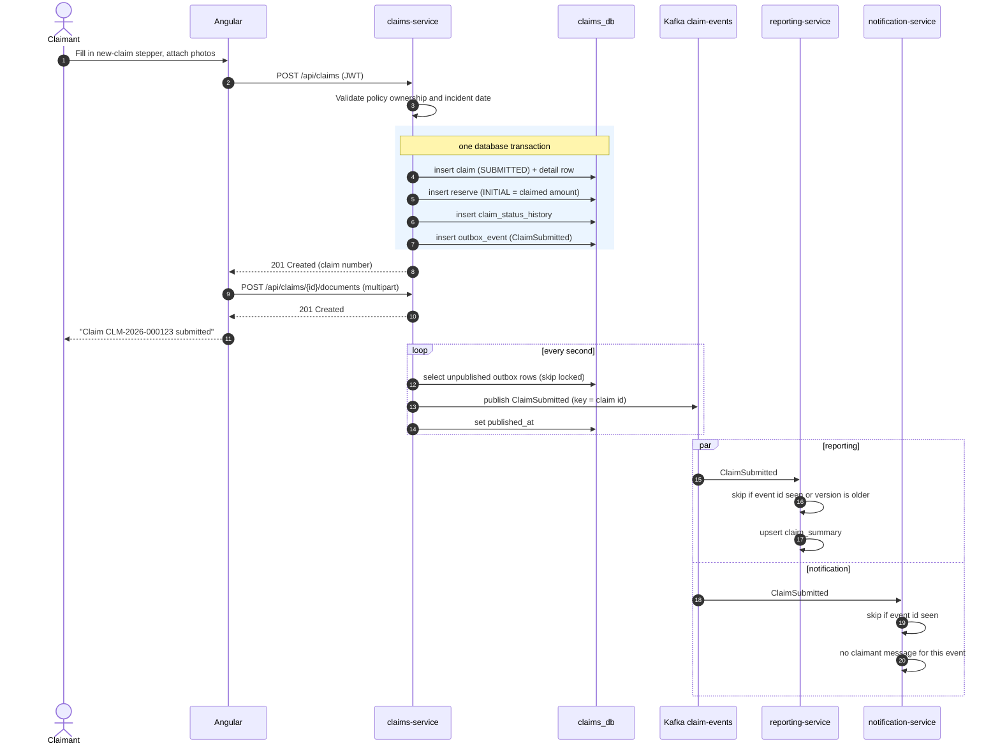
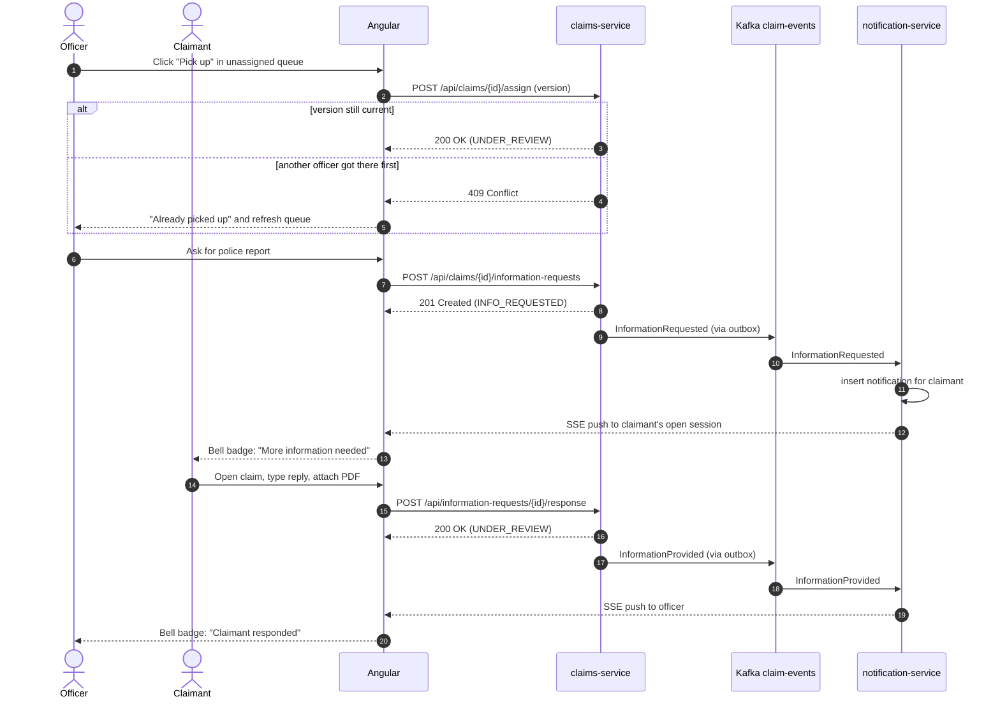
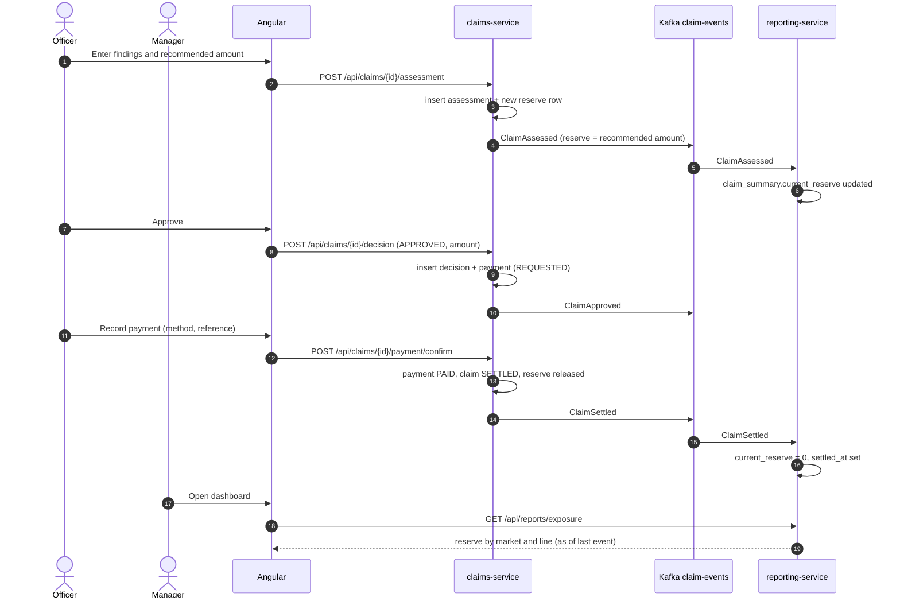
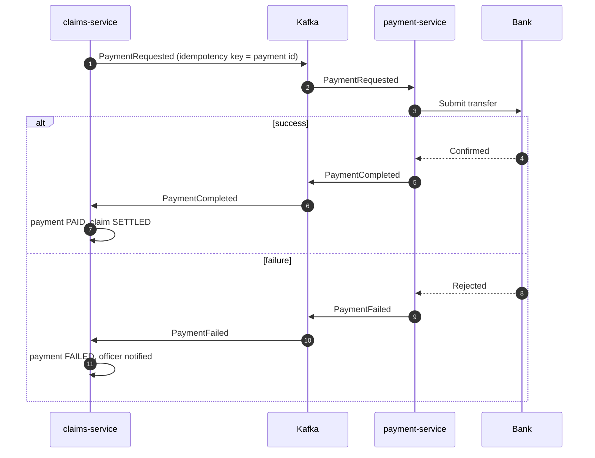

# Sequence Diagrams

## 1. Submit a claim (REST command, outbox, Kafka fan-out)

The pattern every state change follows.

If the service crashes between publishing and setting `published_at`, the event
is published again on restart. Consumers cope because they record each event id
in `processed_event`.

## 2. Pick up, request information, respond (async across both tiers)

## 3. Assess, decide, settle (exposure follows the reserve)

## 4. Future: payment as its own service

Not built. Shows where the thin `payment` table goes next.

