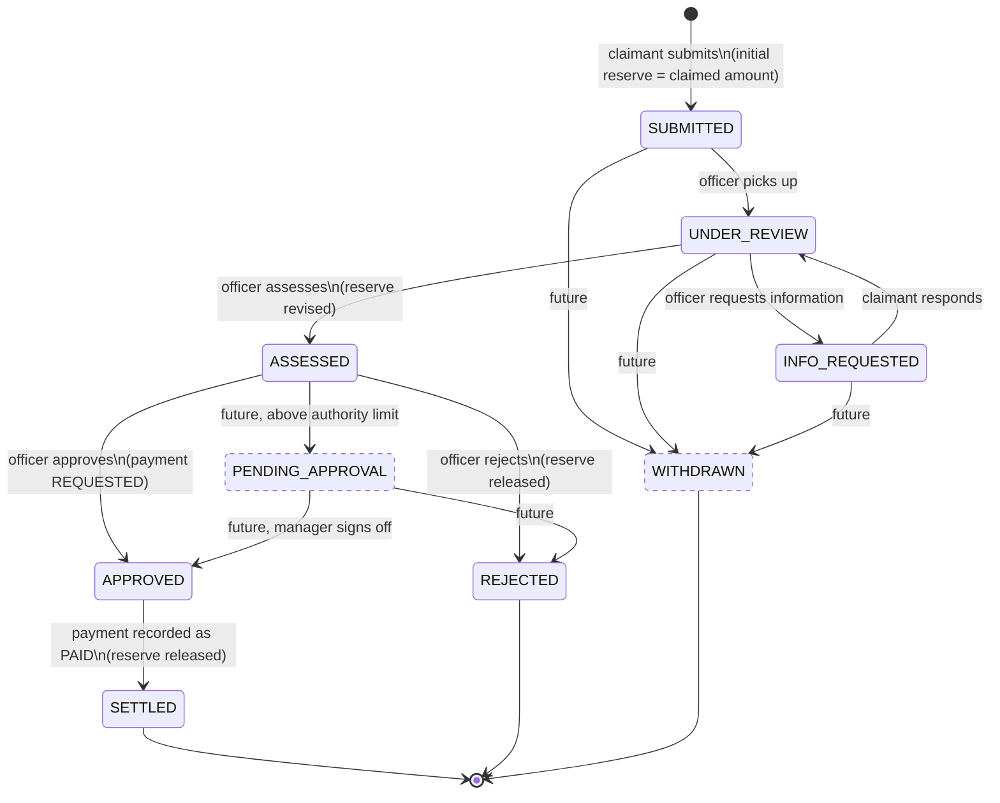
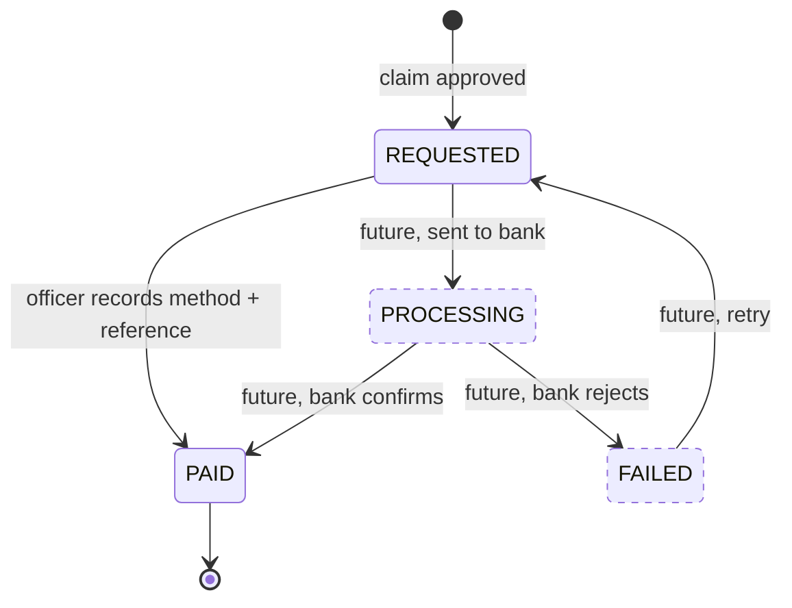
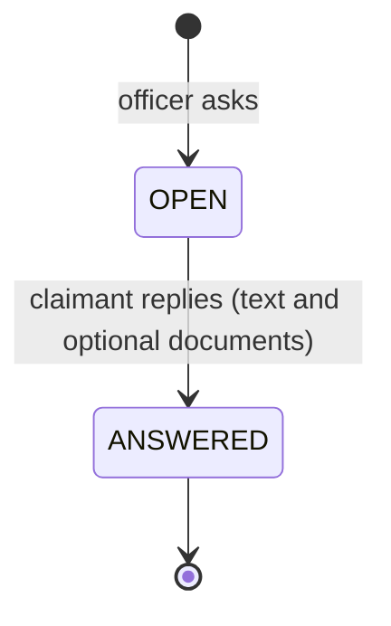

# State Machines

## Claim

Solid states are built. `WITHDRAWN` and `PENDING_APPROVAL` are designed only.

### Transition rules

| Transition | Who | Guard | Event published |
|---|---|---|---|
| submit | Claimant | Policy belongs to claimant; incident date inside policy period | `ClaimSubmitted` |
| pick up | Officer | Claim unassigned; officer's market matches; version matches | `ClaimAssigned` |
| request information | Assigned officer | No other request open | `InformationRequested` |
| respond | Claimant who owns the claim | Request is open | `InformationProvided` |
| assess | Assigned officer | Findings and recommended amount present | `ClaimAssessed` |
| approve | Assigned officer | Approved amount greater than zero and not above sum insured | `ClaimApproved` |
| reject | Assigned officer | Reason present | `ClaimRejected` |
| settle | Assigned officer | Payment method and reference recorded | `ClaimSettled` |

"Officer" means any staff member: a manager can do everything an officer can
(pick up, request information, assess, decide, settle) and additionally sees
the dashboard.

Any other transition is refused with `409 Conflict`. So is a stale `version`,
which is how two officers picking up the same claim is resolved: one wins, the
other gets a 409 and a refreshed queue.

Every successful transition writes a `claim_status_history` row and an
`outbox_event` row in the same transaction as the claim update.

### Open versus closed

Open (counted in workload and exposure): `SUBMITTED`, `UNDER_REVIEW`,
`INFO_REQUESTED`, `ASSESSED`, `APPROVED`.
Closed: `SETTLED`, `REJECTED`.

## Payment

One payment per claim, enforced by a unique constraint on `payment.claim_id`.

## Information request

