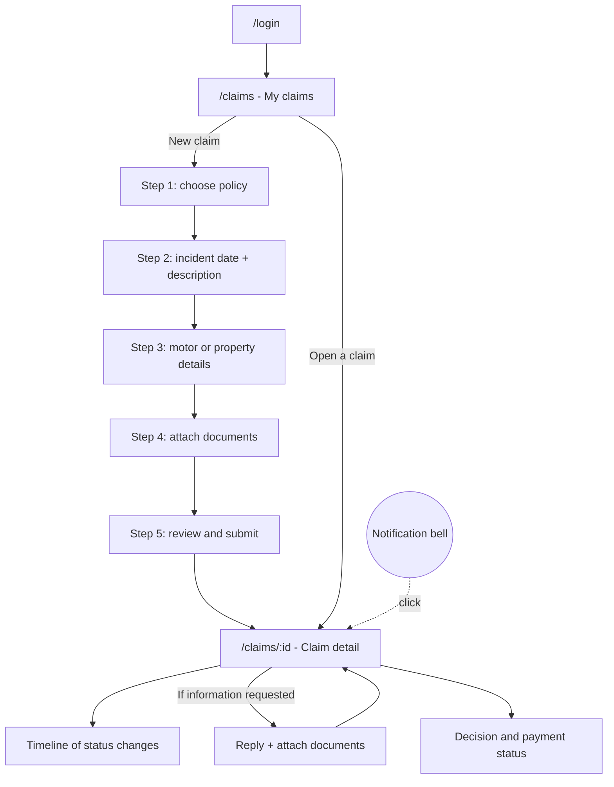
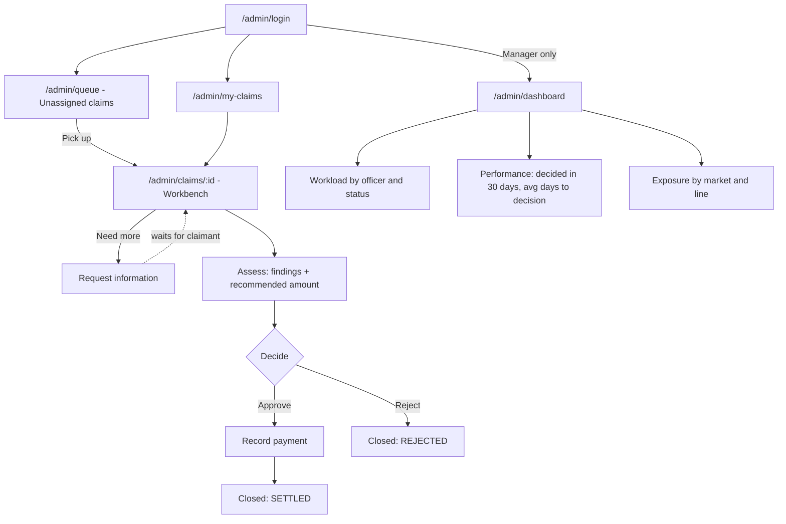

# User Flows and Wireframes

One Angular codebase, two lazy-loaded areas, two login screens. Both logins
call the same endpoint; the server refuses a claimant account at the staff door
and the reverse.

| Area | Login | Routes | Roles |
|---|---|---|---|
| Claimant | `/login` | `/claims/...` | CLAIMANT |
| Staff | `/admin/login` | `/admin/...` | OFFICER, MANAGER |

A manager has every officer capability (queue, pick up, workbench) plus the
dashboard, which officers do not see.

## Claimant flow



## Staff flow



## Wireframes (low fidelity)

### Claimant: My claims (`/claims`)

```
+------------------------------------------------------------------+
| Claims Portal                             (bell 2)   Aisha  v    |
+------------------------------------------------------------------+
| My claims                                        [ + New claim ] |
|                                                                  |
| Claim no.        Type      Incident     Status          Updated  |
| ---------------------------------------------------------------- |
| CLM-2026-000123  Motor     12 Nov 2026  INFO REQUESTED  1h ago  >|
| CLM-2026-000098  Property  02 Oct 2026  SETTLED         3w ago  >|
+------------------------------------------------------------------+
```

### Claimant: New claim stepper (`/claims/new`)

```
+------------------------------------------------------------------+
| New claim                                                        |
| (1) Policy -- (2) Incident -- (3) Details -- (4) Docs -- (5) Review
+------------------------------------------------------------------+
| Step 3 of 5: Motor details                                       |
|                                                                  |
| Vehicle registration  [ WXY 1234        ]                        |
| Driver name           [ Aisha Rahman    ]                        |
| Accident location     [ Jalan Ampang, KL            ]            |
| Third party involved  ( ) Yes  (o) No                            |
|                                                                  |
|                                        [ Back ]   [ Next ]       |
+------------------------------------------------------------------+
```

### Claimant: Claim detail (`/claims/:id`)

```
+------------------------------------------------------------------+
| < My claims     CLM-2026-000123   Motor   [ INFO REQUESTED ]     |
+------------------------------------------------------------------+
| ! More information needed                                        |
|   "Please upload the police report."      - Officer Tan, 1h ago  |
|   [ Your reply...                                  ]             |
|   [ Attach file ]  police-report.pdf (1.2 MB)      [ Send ]      |
+------------------------------------------------------------------+
| Timeline                        | Details                        |
| o 18 Nov 10:02 Info requested   | Policy     MY-MOT-000451       |
| o 18 Nov 09:40 Under review     | Incident   12 Nov 2026         |
| o 18 Nov 09:15 Submitted        | Claimed    MYR 8,500.00        |
|                                 | Documents  photo1.jpg          |
+------------------------------------------------------------------+
```

### Staff: Unassigned queue (`/admin/queue`)

```
+------------------------------------------------------------------+
| Claims Admin   Queue | My claims | Dashboard     (bell 1)  Tan v |
+------------------------------------------------------------------+
| Unassigned claims - Malaysia                  Line: [ All    v ] |
|                                                                  |
| Claim no.        Line      Claimed        Age                    |
| ---------------------------------------------------------------- |
| CLM-2026-000131  Property  MYR 42,000.00  3 days    [ Pick up ]  |
| CLM-2026-000129  Motor     MYR  3,200.00  1 day     [ Pick up ]  |
+------------------------------------------------------------------+
```

### Staff: Claim workbench (`/admin/claims/:id`)

```
+------------------------------------------------------------------+
| < My claims   CLM-2026-000123   Motor   MY   [ UNDER REVIEW ]    |
+------------------------------------------------------------------+
| Claim               | Actions                                    |
| Claimant  A. Rahman | [ Request information ]                    |
| Policy    MY-MOT-.. |                                            |
| Sum ins.  MYR 80,000| Assessment                                 |
| Claimed   MYR 8,500 | Findings   [                          ]    |
| Reserve   MYR 8,500 | Recommended amount  [ MYR 7,200.00 ]       |
| Incident  12 Nov    |                         [ Save assessment ]|
|---------------------|--------------------------------------------|
| Documents           | Decision (enabled once assessed)           |
| photo1.jpg    [get] | [ Approve ]  [ Reject ]                    |
| police-rep.pdf[get] | Payment (enabled once approved)            |
|---------------------| Method [ Bank transfer v ] Ref [        ]  |
| Timeline            |                         [ Record payment ] |
| o Info provided ... |                                            |
+------------------------------------------------------------------+
```

### Manager: Dashboard (`/admin/dashboard`)

```
+------------------------------------------------------------------+
| Claims Admin   Queue | My claims | Dashboard            Lim  v   |
+------------------------------------------------------------------+
| As of 18 Nov 2026 10:05:31                                       |
|                                                                  |
| Open 47   Unassigned 9   Decided (30d) 112   Avg days to decide 6.4
|                                                                  |
| Workload by officer            | Ageing of open claims           |
| Officer   Open  Info req  Assd | 0-2 days   ########   18        |
| Tan         12      3      2   | 3-7 days   ######     14        |
| Kumar        9      1      4   | 8+ days    #######    15        |
| Wong        17      5      1   |                                 |
|--------------------------------+---------------------------------|
| Outstanding exposure (current reserve on open claims)            |
| Market  Motor            Property          Total                 |
| MY      MYR   412,000    MYR 1,930,000     MYR 2,342,000         |
| SG      SGD   188,500    SGD   640,000     SGD   828,500         |
+------------------------------------------------------------------+
```

The "as of" timestamp is deliberate: the dashboard is built from events and
can trail the claims service by a few seconds.
